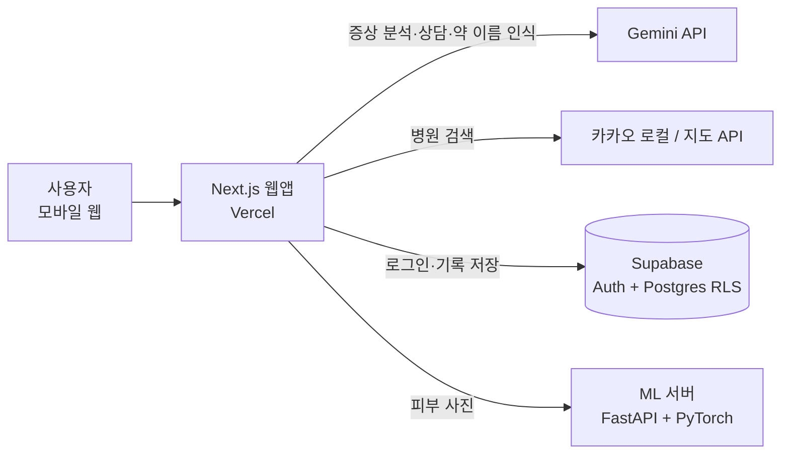

<div align="center">

# HealthMate

**증상 체크부터 병원 찾기, 복약 관리까지 한곳에서 하는 AI 건강 도우미 웹앱**

의료IT공학과 졸업작품 · 지도교수 김상대 교수님 · 20205103 안성훈

[**🔗 배포 사이트**](https://ai-chat-black-nine.vercel.app)


</div>

<p align="center">
  
  
  
  
</p>

---

## 왜 만들었나요?

몸이 아플 때 "어느 과에 가야 하지?", "이 약은 언제 먹더라?" 같은 질문은 흔하지만, 답을 찾으려면 검색·지도·메모 앱을 오가야 합니다. HealthMate는 **증상 입력 → AI 분석 → 진료과 추천 → 주변 병원 → 복약 관리**를 하나의 흐름으로 묶었습니다.

> ⚠️ HealthMate의 모든 결과는 **사전 참고용**이며 의사의 진단을 대신하지 않습니다. 화면마다 이 안내를 표시합니다.

## 주요 기능

| 기능 | 설명 |
|---|---|
| 🩺 **증상 체크** | 인체 그림에서 아픈 부위를 누르고 증상·기간·정도를 5단계로 입력하면, AI가 의심 질환과 진료과를 정리해 줍니다. |
| 📷 **피부 사진 분석** | 피부 증상이면 사진을 함께 올릴 수 있습니다. 직접 학습한 이미지 분류 모델(EfficientNet-B0)이 병변 종류와 확신도를 알려주고, 이 결과를 AI 분석에 함께 넣습니다. |
| 🏥 **주변 병원 찾기** | 추천된 진료과로 현재 위치 반경 5km 안의 병원을 거리순으로 지도에 보여줍니다. (카카오 로컬 API) |
| 💊 **복용/복약 관리** | 약 봉투나 처방전 사진을 찍으면 약 이름을 인식해 등록하고, 복용 시간 알림·주의사항·달력 기록을 제공합니다. |
| 💬 **AI 건강 상담 채팅** | 건강 고민을 대화로 나눌 수 있습니다. 위기 표현(자살·자해 등)이 감지되면 AI 답변 대신 자살예방상담전화 109 안내를 먼저 보여줍니다. |
| 📋 **내 건강 기록** | 지난 증상 체크 결과를 날짜별로 다시 볼 수 있습니다. |

## 시스템 구성



- **웹앱** (`app/`, `components/`, `lib/`): Next.js App Router. AI 호출과 외부 API 키는 모두 서버 라우트(`app/api/*`)에서만 사용합니다.
- **데이터** (`supabase/schema.sql`): 행 단위 보안(RLS)으로 사용자가 자기 기록만 읽고 쓸 수 있게 했습니다.
- **ML 서버** (`ml-service/`): 피부 병변 분류 모델을 FastAPI로 서빙합니다. 추론은 CPU만으로 동작합니다.

## 기술적으로 고민한 부분

### 1. 피부 병변 분류 모델 직접 학습

- 공개 피부경 이미지 데이터셋 **HAM10000**으로 ImageNet 사전학습 **EfficientNet-B0**를 전이학습했습니다.
- 4종 분류: 광선각화증/보웬병(akiec) · 기저세포암(bcc) · 피부섬유종(df) · 혈관 병변(vasc)
- **검증 정확도 91.7%**
- 데이터 정리(`organize_ham10000.py`), 분할(`prepare_data.py`), 학습(`train.py`), 서빙(`serve.py`) 단계마다 pytest 테스트를 두었습니다.

**안전 설계:** 모델 결과를 그대로 "진단"으로 보여주지 않습니다. "○○ 의심 소견 (모델 확신도 N%)" 형태로 AI 분석의 참고 자료로만 넘기고, ML 서버가 꺼져 있거나 8초 안에 응답하지 않으면 사진 없이 텍스트 분석으로 자동 전환됩니다(`lib/skinClassifier.ts`).

### 2. 다중 키워드 탐색 알고리즘: Aho-Corasick (C 직접 구현)

채팅 메시지에서 위기 표현처럼 여러 키워드를 한 번에 찾는 문제를 알고리즘 수준에서 공부하려고, **트라이 → 실패 링크(BFS) → Aho-Corasick 탐색**을 C로 직접 구현하고 자체 채점기로 검증했습니다 (`study/`).

| 입력 | 단순 비교 | Aho-Corasick |
|---|---:|---:|
| 최악 입력 (100만 자, 키워드 1만 자) | 37,466 ms | **5 ms** |
| 긴 반복 패턴 | 262 ms | **4 ms** |
| 무작위 100만 자, 키워드 1,000개 | 28 ms | 14 ms |

단순 비교는 위치마다 가장 긴 키워드 길이만큼 다시 읽어 O(nL)이 되고, 최악 입력에서 **약 7,500배** 차이가 났습니다. 반대로 짧은 무작위 키워드에서는 차이가 작았습니다. 이 결과로 Aho-Corasick의 가치는 평균 속도보다 **최악의 경우를 보장하는 것**에 있다고 정리했습니다. 공부 과정은 [`docs/study/algorithm-study-log.md`](docs/study/algorithm-study-log.md)에, 직접 작성한 코드 목록은 [`docs/study/AUTHORSHIP.md`](docs/study/AUTHORSHIP.md)에 기록했습니다.

> 현재 앱의 위기 감지는 키워드 수가 적어 단순 포함 검사(`lib/crisisDetection.ts`)를 씁니다. Aho-Corasick 적용은 향후 계획입니다.

### 3. 의료 서비스다운 응답 설계

- 위기 표현이 감지되면 AI에게 맡기지 않고, 정해진 안내 문구(109·112·119)를 먼저 보여줍니다.
- 모든 분석 결과 화면에 "사전 참고용이며 반드시 의료기관을 방문하라"는 안내를 고정으로 표시합니다.

## 한계와 향후 계획

- **ML 서버 상시 배포**: 지금은 ML 서버를 로컬 PC에서 실행하고 터널로 연결합니다. 클라우드 상시 배포가 다음 목표입니다.
- **확신도 보정**: 의료에서는 정확도만큼 "확신도를 믿을 수 있는가"가 중요하다고 보고, temperature scaling 등 보정 기법을 적용해 보려 합니다.
- **Aho-Corasick 앱 적용**: 위기 키워드가 늘어나면 공부한 구현을 TypeScript로 옮겨 적용할 계획입니다.
- **웨어러블 연동**: 갤럭시 워치 심박 데이터 연동(Health Connect)과 Android 앱은 개발 중이며 아직 검증 전입니다.

## 실행 방법

### 웹앱

```bash
npm install
cp .env.local.example .env.local   # 키 값 채우기
npm run dev                        # http://localhost:3000
```

필요한 환경 변수: `GEMINI_API_KEY`, `NEXT_PUBLIC_SUPABASE_URL`, `NEXT_PUBLIC_SUPABASE_ANON_KEY`, `KAKAO_REST_API_KEY`, `NEXT_PUBLIC_KAKAO_MAP_APP_KEY` (선택: `ML_SERVICE_URL`). DB 스키마는 `supabase/schema.sql`에 있습니다.

### ML 서버 (선택)

```bash
cd ml-service
pip install -r requirements.txt
uvicorn serve:app --port 8000
```

학습된 가중치 파일(`skin_model.pth`)은 용량 때문에 저장소에 포함하지 않았습니다. HAM10000을 내려받아 `train.py`로 다시 학습할 수 있습니다. ML 서버가 없으면 피부 사진 분석만 빠지고 나머지 기능은 그대로 동작합니다.

## 폴더 구조

```
app/            페이지와 API 라우트 (증상 체크, 채팅, 복약, 건강 기록, 병원 검색)
components/     UI 컴포넌트 (인체 그림, 병원 지도, 복약 카드 등)
lib/            AI 호출, 위기 감지, 병원 검색, Supabase 클라이언트
ml-service/     피부 병변 분류 모델 학습·서빙 (PyTorch, FastAPI)
study/          Aho-Corasick 알고리즘 C 구현과 채점기
supabase/       DB 스키마와 RLS 정책
docs/           설계 문서, 공부 기록, 스크린샷
```

## 출처

- 피부 이미지 데이터: HAM10000 (Tschandl et al., 2018, Harvard Dataverse)
- 인체 그림: MoleMapper body map (Apache-2.0). 자세한 내용은 [`THIRD_PARTY_NOTICES.md`](THIRD_PARTY_NOTICES.md)
