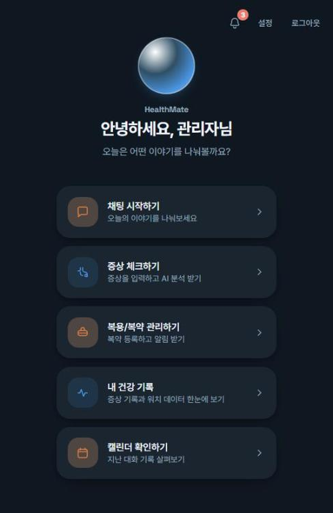
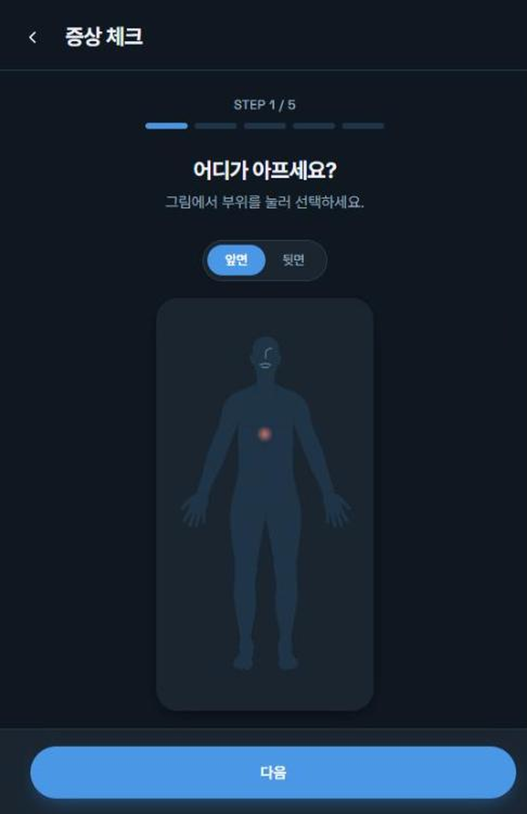
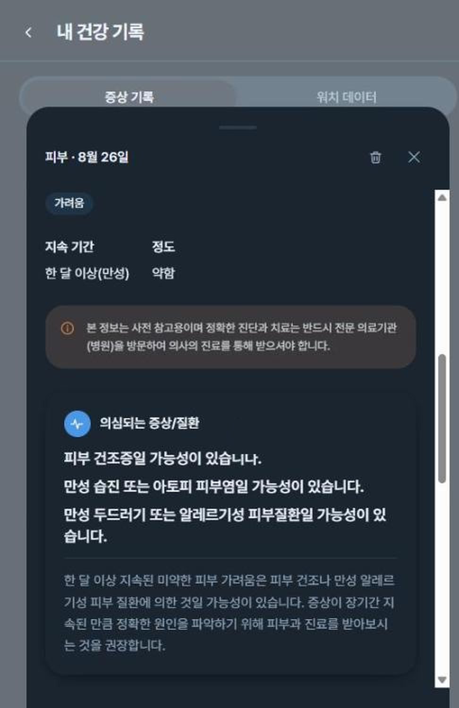
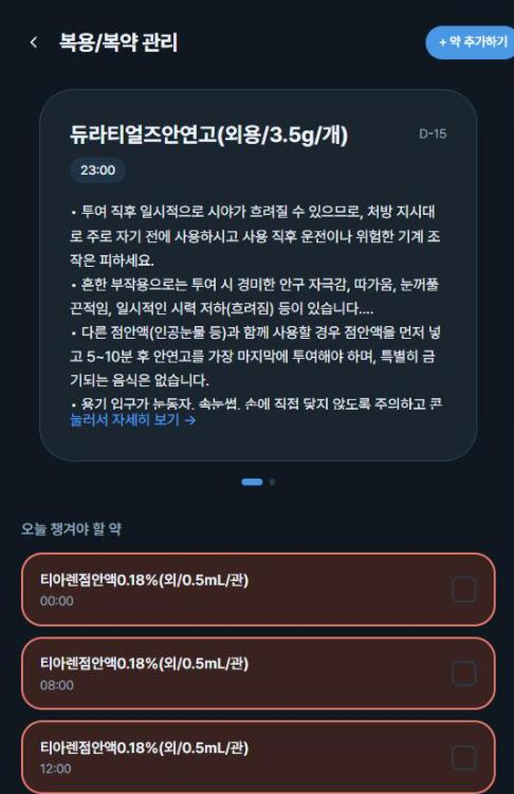
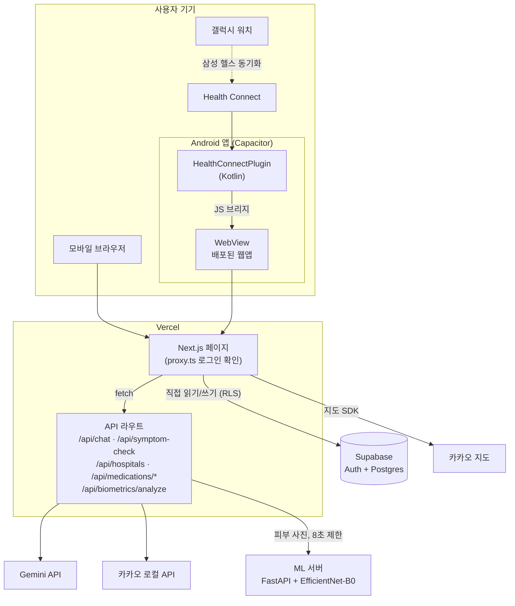
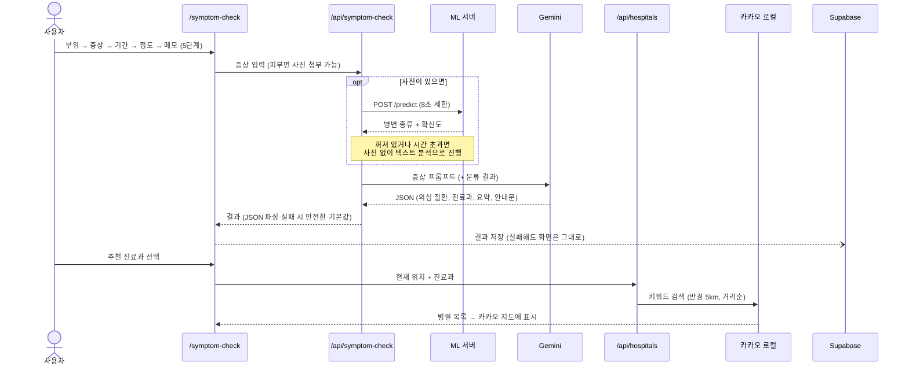
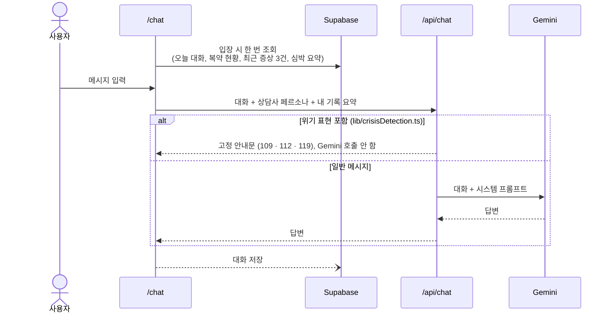
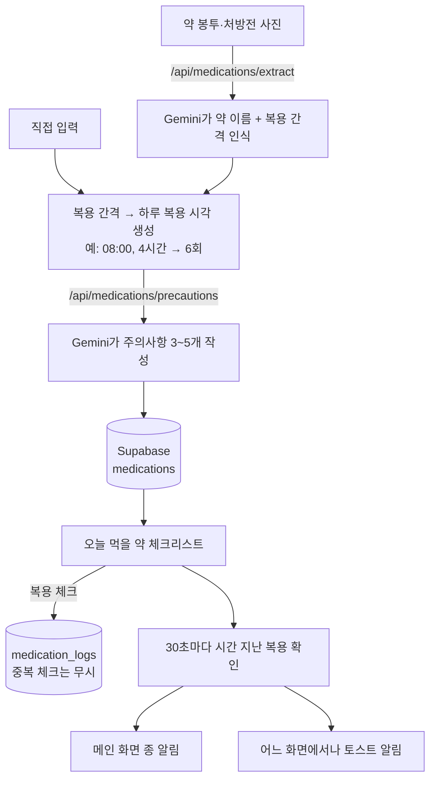
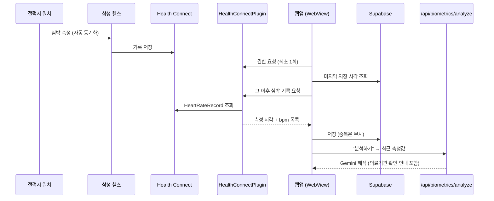
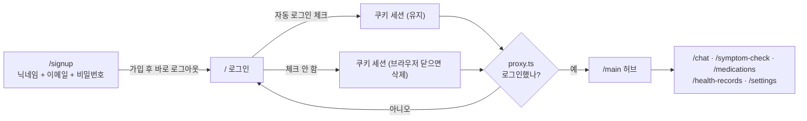

<div align="center">

# HealthMate

**증상 체크부터 병원 찾기, 복약 관리까지 한곳에서 하는 AI 건강 도우미 웹앱**

의료IT공학과 졸업작품 · 지도교수 김상대 교수님 · 20205103 안성훈

[**🔗 배포 사이트**](https://ai-chat-black-nine.vercel.app)


</div>

<p align="center">
  
  
  
  
</p>

---

## 왜 만들었나요?

몸이 아플 때 "어느 과에 가야 하지?", "이 약은 언제 먹더라?" 같은 질문은 흔하지만, 답을 찾으려면 검색·지도·메모 앱을 오가야 합니다. HealthMate는 **증상 입력 → AI 분석 → 진료과 추천 → 주변 병원 → 복약 관리**를 하나의 흐름으로 묶었습니다.

> ⚠️ HealthMate의 모든 결과는 **사전 참고용**이며 의사의 진단을 대신하지 않습니다. 화면마다 이 안내를 표시합니다.

## 주요 기능

| 기능 | 설명 |
|---|---|
| 🩺 **증상 체크** | 인체 그림에서 아픈 부위를 누르고 증상·기간·정도를 5단계로 입력하면, AI가 의심 질환과 진료과를 정리해 줍니다. |
| 📷 **피부 사진 분석** | 피부 증상이면 사진을 함께 올릴 수 있습니다. 직접 학습한 이미지 분류 모델(EfficientNet-B0)이 병변 종류와 확신도를 알려주고, 이 결과를 AI 분석에 함께 넣습니다. |
| 🏥 **주변 병원 찾기** | 추천된 진료과로 현재 위치 반경 5km 안의 병원을 거리순으로 지도에 보여줍니다. (카카오 로컬 API) |
| 💊 **복용/복약 관리** | 약 봉투나 처방전 사진을 찍으면 약 이름을 인식해 등록하고, 복용 시간 알림·주의사항·달력 기록을 제공합니다. |
| 💬 **AI 건강 상담 채팅** | 건강 고민을 대화로 나눌 수 있습니다. 위기 표현(자살·자해 등)이 감지되면 AI 답변 대신 자살예방상담전화 109 안내를 먼저 보여줍니다. |
| 📋 **내 건강 기록** | 지난 증상 체크 결과를 날짜별로 다시 볼 수 있습니다. |

## 기술 스택과 선택 이유

| 영역 | 선택 | 왜 골랐나 |
|---|---|---|
| 웹 프레임워크 | **Next.js 16 (App Router)**, React 19 | 화면과 서버 API(`app/api/*`)를 한 저장소에서 만들 수 있습니다. Gemini·카카오 키를 서버 라우트에만 두어 브라우저에 노출하지 않으려고 골랐습니다. |
| 언어 · 스타일 | **TypeScript**, **Tailwind CSS 4** | AI 응답(JSON)과 DB 레코드에 타입을 붙여 필드 누락을 컴파일 단계에서 잡습니다. 색은 CSS 변수 토큰으로 정의해 OS 다크 모드를 따라갑니다. |
| 인증 · DB | **Supabase** (Auth + Postgres) | 별도 백엔드 서버 없이 브라우저에서 바로 DB를 읽고 씁니다. 대신 모든 테이블에 RLS(`auth.uid() = user_id`)를 걸어 남의 기록은 읽을 수 없게 했습니다. 세션을 쿠키에 저장해 `proxy.ts`가 서버에서 로그인 여부를 확인합니다. |
| AI | **Gemini API** (REST 직접 호출) | 사진 입력(처방전 약 이름 인식)과 JSON 형식 응답이 모두 필요했습니다. SDK 없이 `fetch`로 호출해 의존성을 줄였습니다. |
| AI (개발용) | Ollama + `exaone3.5:7.8b` | 개발 중에는 로컬 모델로 비용 없이 실험합니다(`lib/ai.ts`에서 전환). 처음 쓴 qwen2.5가 답변 중간에 중국어를 섞어서, 한국어에 맞춰 학습된 EXAONE으로 바꿨습니다. 배포 환경에서는 항상 Gemini를 씁니다. |
| 지도 · 병원 검색 | **카카오 로컬 / 지도 API** | 처음에는 네이버 API를 썼는데, 카카오 키워드 검색은 좌표와 반경을 바로 받아 거리순으로 돌려줍니다. 주소 변환 단계가 하나 줄어서 옮겼습니다. |
| 이미지 모델 | **PyTorch**, EfficientNet-B0 전이학습 | GPU 12GB와 개발 기간 한 달 안에서 처음부터 학습하는 것은 무리였습니다. ImageNet으로 사전학습된 가벼운 모델을 가져와 피부 병변 4종에 맞게 다시 학습했습니다. |
| 모델 서빙 | **FastAPI** | 모델이 Python이라 같은 언어로 `POST /predict` 하나만 여는 작은 서버를 따로 두었습니다. 웹앱과 코드를 공유하지 않아서, 서버가 꺼져도 웹앱은 영향을 받지 않습니다. |
| 안드로이드 · 워치 | **Capacitor** + Kotlin 플러그인, Health Connect | 웹앱만으로는 워치 심박 데이터를 읽을 수 없습니다. 배포된 웹앱을 앱으로 감싸고, 삼성 헬스가 Health Connect에 동기화한 기록을 네이티브 플러그인으로 읽습니다. 워치 전용 앱을 따로 만들지 않아도 됩니다. |
| 배포 | **Vercel** | GitHub에 push하면 자동으로 배포됩니다. |

## 아키텍처



- **두 갈래의 데이터 경로:** 기록 저장과 조회는 브라우저에서 Supabase로 직접 갑니다. RLS가 사용자를 구분해서 중간 서버가 필요 없습니다. 외부 API 키가 필요한 호출(AI, 병원 검색, 이미지 분류)만 서버 라우트를 거칩니다.
- **로그인 확인은 한 곳에서:** `proxy.ts`가 보호할 페이지 목록만 지정해 로그인 여부를 확인합니다. 페이지마다 따로 두었던 확인 코드 5개를 이 파일 하나로 합쳤습니다. `/api/*`는 이 목록에 넣지 않아서, Supabase 장애가 AI 기능까지 막지 않습니다.
- **선택 기능은 꺼져도 괜찮게:** ML 서버나 워치 연동이 없어도 나머지 기능은 그대로 동작합니다.

## 주요 흐름

<details open>
<summary><b>1. 증상 체크 → 진료과 추천 → 주변 병원</b></summary>


</details>

<details>
<summary><b>2. AI 상담 채팅과 위기 표현 감지</b></summary>


</details>

<details>
<summary><b>3. 복약 등록과 복용 알림</b></summary>


</details>

<details>
<summary><b>4. 갤럭시 워치 심박수 연동 (개발 중)</b></summary>


</details>

<details>
<summary><b>5. 회원가입 · 로그인 · 페이지 보호</b></summary>


</details>

## 기술적으로 고민한 부분

### 1. 피부 병변 분류 모델 직접 학습

- 공개 피부경 이미지 데이터셋 **HAM10000**으로 ImageNet 사전학습 **EfficientNet-B0**를 전이학습했습니다.
- 4종 분류: 광선각화증/보웬병(akiec) · 기저세포암(bcc) · 피부섬유종(df) · 혈관 병변(vasc)
- **검증 정확도 91.7%**
- 데이터 정리(`organize_ham10000.py`), 분할(`prepare_data.py`), 학습(`train.py`), 서빙(`serve.py`) 단계마다 pytest 테스트를 두었습니다.

**안전 설계:** 모델 결과를 그대로 "진단"으로 보여주지 않습니다. "○○ 의심 소견 (모델 확신도 N%)" 형태로 AI 분석의 참고 자료로만 넘기고, ML 서버가 꺼져 있거나 8초 안에 응답하지 않으면 사진 없이 텍스트 분석으로 자동 전환됩니다(`lib/skinClassifier.ts`).

### 2. 다중 키워드 탐색 알고리즘: Aho-Corasick (C 직접 구현)

채팅 메시지에서 위기 표현처럼 여러 키워드를 한 번에 찾는 문제를 알고리즘 수준에서 공부하려고, **트라이 → 실패 링크(BFS) → Aho-Corasick 탐색**을 C로 직접 구현하고 자체 채점기로 검증했습니다 (`study/`).

| 입력 | 단순 비교 | Aho-Corasick |
|---|---:|---:|
| 최악 입력 (100만 자, 키워드 1만 자) | 37,466 ms | **5 ms** |
| 긴 반복 패턴 | 262 ms | **4 ms** |
| 무작위 100만 자, 키워드 1,000개 | 28 ms | 14 ms |

단순 비교는 위치마다 가장 긴 키워드 길이만큼 다시 읽어 O(nL)이 되고, 최악 입력에서 **약 7,500배** 차이가 났습니다. 반대로 짧은 무작위 키워드에서는 차이가 작았습니다. 이 결과로 Aho-Corasick의 가치는 평균 속도보다 **최악의 경우를 보장하는 것**에 있다고 정리했습니다. 공부 과정은 [`docs/study/algorithm-study-log.md`](docs/study/algorithm-study-log.md)에, 직접 작성한 코드 목록은 [`docs/study/AUTHORSHIP.md`](docs/study/AUTHORSHIP.md)에 기록했습니다.

> 현재 앱의 위기 감지는 키워드 수가 적어 단순 포함 검사(`lib/crisisDetection.ts`)를 씁니다. Aho-Corasick 적용은 향후 계획입니다.

### 3. 의료 서비스다운 응답 설계

- 위기 표현이 감지되면 AI에게 맡기지 않고, 정해진 안내 문구(109·112·119)를 먼저 보여줍니다.
- 모든 분석 결과 화면에 "사전 참고용이며 반드시 의료기관을 방문하라"는 안내를 고정으로 표시합니다.

## 한계와 향후 계획

- **ML 서버 상시 배포**: 지금은 ML 서버를 로컬 PC에서 실행하고 터널로 연결합니다. 클라우드 상시 배포가 다음 목표입니다.
- **확신도 보정**: 의료에서는 정확도만큼 "확신도를 믿을 수 있는가"가 중요하다고 보고, temperature scaling 등 보정 기법을 적용해 보려 합니다.
- **Aho-Corasick 앱 적용**: 위기 키워드가 늘어나면 공부한 구현을 TypeScript로 옮겨 적용할 계획입니다.
- **웨어러블 연동**: 갤럭시 워치 심박 데이터 연동(Health Connect)과 Android 앱은 개발 중이며 아직 검증 전입니다.

## 실행 방법

### 웹앱

```bash
npm install
cp .env.local.example .env.local   # 키 값 채우기
npm run dev                        # http://localhost:3000
```

필요한 환경 변수: `GEMINI_API_KEY`, `NEXT_PUBLIC_SUPABASE_URL`, `NEXT_PUBLIC_SUPABASE_ANON_KEY`, `KAKAO_REST_API_KEY`, `NEXT_PUBLIC_KAKAO_MAP_APP_KEY` (선택: `ML_SERVICE_URL`). DB 스키마는 `supabase/schema.sql`에 있습니다.

### ML 서버 (선택)

```bash
cd ml-service
pip install -r requirements.txt
uvicorn serve:app --port 8000
```

학습된 가중치 파일(`skin_model.pth`)은 용량 때문에 저장소에 포함하지 않았습니다. HAM10000을 내려받아 `train.py`로 다시 학습할 수 있습니다. ML 서버가 없으면 피부 사진 분석만 빠지고 나머지 기능은 그대로 동작합니다.

## 패키지 구조

```
ai-chat/
├── app/                        # Next.js App Router (페이지 + 서버 API)
│   ├── page.tsx                #   로그인
│   ├── signup/                 #   회원가입
│   ├── main/                   #   메인 허브 (기능 카드, 복용 알림 종)
│   ├── symptom-check/          #   5단계 증상 체크 → 결과 → 병원 지도
│   ├── chat/                   #   오늘의 AI 상담 채팅
│   ├── chats/                  #   지난 대화 달력 → [date] 날짜별 다시 보기
│   ├── medications/            #   복약 카드 + 오늘 체크리스트, add/ 약 등록
│   ├── health-records/         #   증상 기록 · 워치 데이터 탭
│   ├── settings/               #   닉네임 변경
│   └── api/                    #   서버 전용 (API 키는 여기서만 사용)
│       ├── chat/               #     위기 감지 → Gemini 상담
│       ├── symptom-check/      #     (피부 분류) → Gemini 증상 분석
│       ├── hospitals/          #     카카오 로컬 병원 검색
│       ├── medications/        #     extract(사진 → 약 이름), precautions(주의사항)
│       └── biometrics/analyze/ #     심박수 Gemini 해석
├── components/                 # UI 컴포넌트
│   ├── BodyDiagram.tsx         #   부위를 고르는 인체 그림 (SVG)
│   ├── HospitalMap.tsx         #   위치 확인 + 카카오 지도 마커
│   ├── SymptomResultView.tsx   #   증상 분석 결과 화면
│   ├── CardDeck.tsx            #   넘기는 카드 묶음 (복약, 증상 기록)
│   ├── DoseToaster.tsx         #   어느 화면에서나 뜨는 복용 알림
│   └── ...                     #   채팅 말풍선, 심박 차트, 상세 시트 등
├── lib/                        # 화면과 분리한 로직
│   ├── ai.ts                   #   AI 라우터 (Gemini / 개발용 Ollama)
│   ├── gemini.ts · ollama.ts   #   각 모델 REST 호출
│   ├── symptomCheck.ts         #   증상 프롬프트 + JSON 파싱(실패 시 기본값)
│   ├── chatPersona.ts          #   상담사 말투·원칙 프롬프트
│   ├── crisisDetection.ts      #   위기 표현 감지 + 고정 안내문
│   ├── skinClassifier.ts       #   ML 서버 호출 (8초 제한, 실패 시 null)
│   ├── hospitals.ts            #   카카오 로컬 검색
│   ├── medications.ts          #   복약 CRUD, 복용 시각 생성, 오늘 체크리스트 계산
│   ├── doseNotifications.ts    #   복용 알림 (본 것 / 띄운 것 따로 관리)
│   ├── chatHistory.ts · symptomHistory.ts · biometrics.ts  # Supabase 기록 읽기/쓰기
│   ├── nativeHealthConnect.ts  #   Capacitor 플러그인 JS 쪽 연결
│   └── supabase/client.ts      #   브라우저용 Supabase 클라이언트 (쿠키 세션)
├── proxy.ts                    # 보호 페이지 로그인 확인 (Next 16의 middleware)
├── supabase/schema.sql         # 테이블 + RLS 정책
├── ml-service/                 # 피부 병변 분류 (Python, 웹앱과 분리)
│   ├── organize_ham10000.py    #   데이터 정리
│   ├── prepare_data.py         #   학습/검증 분할
│   ├── train.py · model.py     #   EfficientNet-B0 전이학습
│   ├── serve.py                #   FastAPI POST /predict
│   └── test_*.py               #   단계별 pytest
├── android-shell/              # Capacitor 안드로이드 앱
│   └── android/.../HealthConnectPlugin.kt  # Health Connect 심박 읽기
├── study/                      # Aho-Corasick C 구현 + 자체 채점기
└── docs/
    ├── superpowers/            #   기능별 설계(specs) · 구현 계획(plans)
    ├── study/                  #   알고리즘 공부 기록, 직접 작성 코드 목록
    └── images/                 #   README 스크린샷
```

## 출처

- 피부 이미지 데이터: HAM10000 (Tschandl et al., 2018, Harvard Dataverse)
- 인체 그림: MoleMapper body map (Apache-2.0). 자세한 내용은 [`THIRD_PARTY_NOTICES.md`](THIRD_PARTY_NOTICES.md)
